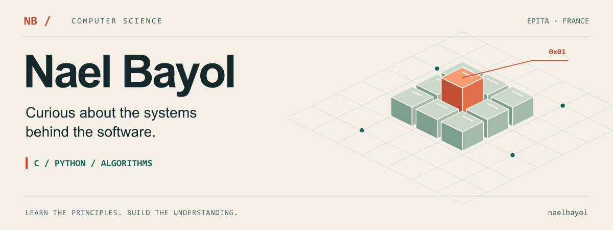
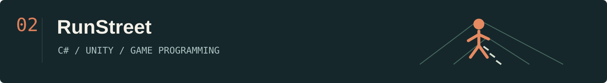
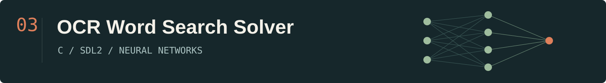
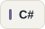
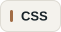
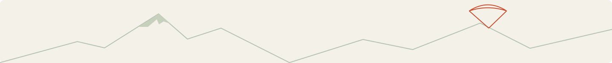

<!-- Upload this README.md AND the complete assets/ directory to naelbayol/naelbayol. -->
<picture>
  <source media="(prefers-reduced-motion: reduce) and (prefers-color-scheme: dark)" srcset="./assets/hero-dark.svg" />
  <source media="(prefers-reduced-motion: reduce)" srcset="./assets/hero-light.svg" />
  <source media="(prefers-color-scheme: dark)" srcset="./assets/hero-dark.gif" />
  <source media="(prefers-color-scheme: light)" srcset="./assets/hero-light.gif" />
  
</picture>

<strong>Computer science engineering student at EPITA, based in France.</strong> 
I enjoy understanding how software works, from memory allocation and data structures to game logic and neural networks.

<blockquote>
<strong>Seeking a five-month international software engineering internship from September 2027.</strong>
</blockquote>

<h2>Selected work</h2>

<a href="https://github.com/naelbayol/My_malloc"><picture><source media="(max-width: 600px)" srcset="./assets/project-memory-compact.svg" /></picture></a>

An academic implementation of <code>malloc</code>, <code>calloc</code>, <code>realloc</code> and <code>free</code> in C. Memory obtained through <code>mmap</code>, managed with block metadata, splitting and coalescing.

<a href="https://github.com/naelbayol/My_malloc"><strong>Explore the code</strong></a>

<picture><source media="(max-width: 600px)" srcset="./assets/project-runstreet-compact.svg" /></picture>

I handled the programming for our student team game: player controls, collisions, audio and initial networking components with Unity Netcode.

<a href="https://github.com/NotSamSam/OCR-Word-Search-Solver"><picture><source media="(max-width: 600px)" srcset="./assets/project-ocr-compact.svg" /></picture></a>

A team project exploring character recognition and word-search solving. My contribution focused on neural-network research and understanding the implementation: pixel inputs, weights, biases, activations and prediction. After my initial coding attempts, I used AI to generate the final neural-network code and studied it in detail for our presentation.

<a href="https://github.com/NotSamSam/OCR-Word-Search-Solver"><strong>Explore the team repository</strong></a>

<h2>Technical toolkit</h2>

My main languages are <strong>C and Python</strong>. This toolkit reflects coursework, projects and earlier exploration; experience varies across technologies.

<strong>Main focus</strong>

<picture></picture>
<picture></picture>

<strong>Programming &amp; web</strong>

<picture></picture>
<picture></picture>
<picture></picture>
<picture></picture>
<picture></picture>

<strong>Engines &amp; frameworks</strong>

<picture></picture>
<picture></picture>
<picture></picture>
<picture></picture>

<strong>Development environment</strong>

<picture></picture>
<picture></picture>
<picture></picture>
<picture></picture>
<picture></picture>
<picture></picture>
<picture></picture>
<picture></picture>
<picture></picture>

<strong>Earlier coursework &amp; exploration</strong>

<picture></picture>
<picture></picture>
<picture></picture>
<picture></picture>

<h2>What drives my curiosity</h2>

I'm interested in <strong>artificial intelligence, optimization and quantitative finance</strong>. I'm developing my understanding of machine learning and the mathematics behind it, alongside hands-on software projects.

<strong>AI-assisted experiments</strong>

I also use AI-generated code to investigate ideas and study how software components fit together.

<ul>
  <li><strong>NeuroTrader:</strong> explored architectural choices and an oracle combining several AI analysis roles. The implementation code was generated with AI tools.</li>
  <li><strong>Weather &amp; paragliding dashboard:</strong> explored weather information and flight conditions through a personal prototype built with AI-generated code.</li>
  <li><strong>Other experiments:</strong> a photo website, an image editor and an audio-detection script, built with AI assistance.</li>
</ul>

 

<picture></picture>

<strong>Outside code: paragliding, skiing and time outdoors.</strong> France → an international software engineering experience.

